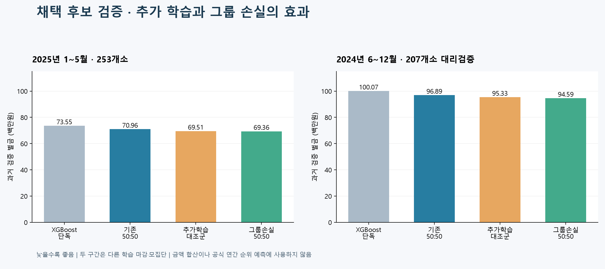

# XGBoost + 그룹 손실 TCN — 2026-11-05 최종 후보

최종 구성은 **기존 177개 특징 XGBoost 50% + 그룹 손실로 추가 학습한 TCN 50%**입니다.
기존 G1/G2 배정은 유지했습니다. Bi-GRU나 Attention을 결합한 최종 모델은 아닙니다.

## 실제 대회 제출 결과

사용자가 제공한 대회 제출 내역 화면 기준입니다.

| 항목 | 기록 |
|---|---|
| 실제 정산금 S | **6,449,167,751원** |
| 제출 화면의 구성 파일명 | `composition (1).csv` |
| 제출 화면의 예측 파일명 | `forecast (1).csv` |
| 제출 일시 | 2026-11-05 22:49… — 화면에서 초 이하가 잘림 |
| 모델 구성 | XGBoost 50% + 그룹 손실로 추가 학습한 TCN 50% |

위 금액은 과거 검증 벌금이 아니라 **실제 대회 화면에 표시된 정산금**이며, 높을수록 좋습니다.
아래 과거 검증 표의 벌금은 낮을수록 좋으므로 두 금액을 직접 비교하지 않습니다.
이 모델의 제출 결과로 사용자가 전달한 화면을 기록했으며, 화면에 나온 파일과 로컬 생성 파일의 바이트 동일성은 별도로 대조하지 않았습니다.
화면 왼쪽의 숫자 `6`은 순위라고 확인할 수 없어 등수로 기록하지 않았습니다.
기존 검증 보고서의 `official_score_known: false`는 제출 파일 생성 당시의 상태이며, 이 실제 결과는 이후 추가된 기록입니다.

## 과거 검증 결과

| 검증 기간 | XGBoost 단독 | 기존 XGB·TCN 50:50 | 추가학습 대조군 50:50 | 채택 후보 50:50 |
|---|---:|---:|---:|---:|
| 2025년 1~5월 · 253개소 | 73,554,800원 | 70,955,688원 | 69,506,626원 | **69,363,692원** |
| 2024년 6~12월 · 207개소 대리검증 | 100,068,170원 | 96,887,419원 | 95,328,811원 | **94,588,615원** |

기존 50:50 대비 벌금은 각각 **2.24%, 2.37%** 감소했습니다. 추가 학습 자체의 효과도 포함되며,
같은 학습량의 대조군 대비 그룹 손실의 추가 절감은 각각 약 14.3만원, 74.0만원입니다.
과거 기간을 반복 검토한 이력이 있고, 두 검증 구간의 모집단이 다릅니다.
공식 평가 연도의 정산금·순위 또는 1등과의 격차 해소를 보장하지 않습니다.



## 무엇을 바꿨나

- TCN은 24시간 × 31개 특징과 결측 표시 31개를 사용합니다.
- 기존 학습 후 학습률 0.0001로 2회 추가 학습합니다.
- 손실은 개별 가중 절대오차 20% + 관측 가용 발전소의 그룹 잔차합 절대오차 80%입니다.
- 과거 실적이 불완전해 학습 손실은 관측 부분집합 기준이며 공식 전체 253개소 손실과 완전히 같지 않습니다.
- 발전소별 배율 보정과 명시적 발전소 이득 파라미터는 검증 기준 미달로 채택하지 않았습니다.
- 제출 후보 TCN은 2025-05-31 17:00 이전 허용 역사에서 완료된 하루 묶음으로 재학습했습니다.

## 파일 안내

- [상세 개선 보고서](reports/최종_개선보고서.md)
- [월별 검증 비교](reports/채택모델_월별비교.csv)
- [그룹 손실 검증 원결과](reports/그룹손실_추가학습_검증.json)
- [최종 제출 형식 검증](reports/submission_validation.json)
- [최종 학습·예측·검증 코드](work/xgb1103-improve/export_xgb_tcn_candidate.py)
- [그룹 손실 추가 학습 코드](work/xgb1103-improve/tcn_group_finetune.py)
- [TCN 구조와 특징](work/xgb1103-improve/tcn_candidate.py)
- [XGBoost 특징 정의](work/xgb1103-improve/expanded_features.json)

최종 파일은 253개소, G1 20,465.655kW / G2 22,189.715kW,
8,760시간 × 2개 그룹 = 17,520행으로 검사했습니다.
야간 0, 음수·결측·무한대, 개별 예측의 독립 합산과 50:50 산식도 검사했습니다.

## 모델 관련 파일명과 역할

코드 경로의 기준은 이 폴더의 `work/xgb1103-improve/`입니다.

| 파일명 | 역할 | 최종 모델에서의 위치 |
|---|---|---|
| `export_xgb_tcn_candidate.py` | 후보 선택, 최종 TCN 재학습, 50:50 결합 예측, 제출 형식 검사 | 최종 실행 진입점 |
| `tcn_candidate.py` | TCN 구조, 31개 입력 특징, 정규화 및 기본 학습 | 사용 |
| `tcn_group_finetune.py` | 개별 손실 20% + 그룹 손실 80%로 TCN 추가 학습 | 사용 |
| `experiment.py` | 특징 구성, 예보 수정량, XGBoost 설정 등 공통 함수 | 공통 코드 |
| `expanded_features.json` | XGBoost 177개 특징 목록 | 사용 |
| `reference/baseline_reference.py` | 기상 예보와 태양 위치 등 기본 특징 계산 | 공통 코드 |
| `reference/run_experiment.py` | 확장 특징 계산 및 기존 실험 지원 | 공통 코드 |
| `reference/feature_sets.json` | 기존 특징 조합 정의 | 공통 설정 |
| `xgb_loss_trial.py` | XGBoost 손실함수 비교 및 원본 보존 검사 함수 | 손실 변경은 미채택, 보존 검사 함수 사용 |
| `deep_linear_ensemble.py` | TCN·Bi-GRU·Attention 비교 실험 및 시계열 입력 준비 함수 | 3종 앙상블은 미채택, 일부 공통 함수 사용 |
| `site_adaptation_diagnostics.py` | 지역·관측소·예보 데이터 진단 | 진단용 |
| `tcn_site_adaptation.py` | 발전소별 이득을 학습하는 TCN 실험 | 미채택 |
| `tcn_site_calibration.py` | 과거 예측 기반 발전소별 배율 보정 실험 | 미채택 |
| `complete_site_improvement.py` | 검증 비교 표·그래프·보고서와 로컬 코드 묶음 생성 | 결과 정리 |

학습된 가중치와 정규화 파일은 로컬에 보관합니다. 같은 `model.pt` 이름의 중간 모델과 혼동하지 않도록 최종 경로를 구분합니다.

| 로컬 파일 경로 — 프로젝트 루트 기준 | 내용 |
|---|---|
| `work/xgb1103-improve/production177/model.ubj` | 최종 결합에 사용한 기존 XGBoost 가중치 |
| `work/xgb1103-improve/production_xgb_tcn_20261105/tune/production/group_aligned/model.pt` | 그룹 손실 추가 학습을 마친 최종 TCN 가중치 |
| `work/xgb1103-improve/production_xgb_tcn_20261105/base/production/scaler.npz` | 허용 학습 기간에서 계산한 TCN 정규화 통계 |
| `outputs/OIBC_XGB_TCN_제출후보_20261105/composition.csv` | 로컬에서 생성한 253개 발전소의 G1/G2 구성 |
| `outputs/OIBC_XGB_TCN_제출후보_20261105/forecast.csv` | 로컬에서 생성한 17,520행의 그룹별 예측 |

## 로컬 재실행

이 폴더는 기존 프로젝트에 덧붙이는 코드·집계 보고서입니다.
대회 원본 데이터, 제출용 composition.csv/forecast.csv, 시간별 개별 예측,
학습된 모델과 대용량 특징 캐시는 공개하지 않습니다.
따라서 이 폴더만 내려받아 새 PC에서 바로 실행되는 독립 패키지는 아닙니다.
보고서의 outputs 경로는 작업 당시 로컬 경로입니다.

기존 프로젝트와 동일하게 work/data 및 work/xgb1103-improve 아래의 기존 캐시·모델·검증 예측과
원본 제출 파일을 준비하고, 이 폴더를 작업 루트로 사용합니다.
기존 참조 코드는 ../xgboost_177_submission 폴더에도 보존되어 있습니다.
필요 라이브러리는 Python 3.12, numpy, pandas, pyarrow, xgboost, lightgbm,
scikit-learn, scipy, torch이며 그래프에는 matplotlib이 필요합니다.
실험 당시 XGBoost는 3.4.1, pandas는 3.0.1을 사용했습니다.
PyTorch를 별도 경로에 설치한 경우에만 환경 변수 OIBC_TORCH_LIBS를 지정하십시오.
공개본은 이 환경 경로 처리만 조정했고 모델·학습 수식은 변경하지 않았습니다.

```shell
python work/xgb1103-improve/export_xgb_tcn_candidate.py train
python work/xgb1103-improve/export_xgb_tcn_candidate.py predict
python work/xgb1103-improve/export_xgb_tcn_candidate.py validate
```

기존 완료 파일을 덮어쓰지 않도록 설계되어 있습니다. 새 실험은 RUN/PROD/OUT 경로를 분리하십시오.
대회 데이터는 로컬에서만 처리하고 외부 AI 서비스에 업로드하지 않습니다.
온라인 대회 제출은 자동 실행하지 않았습니다.
